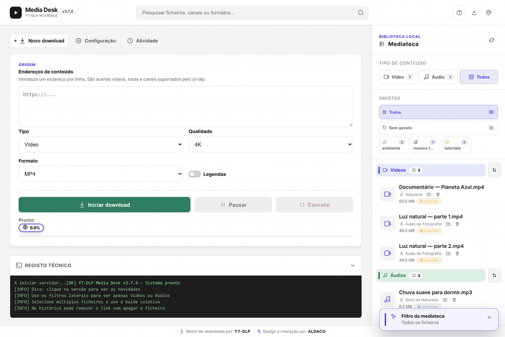
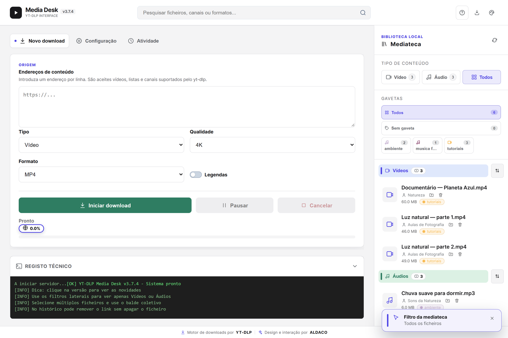
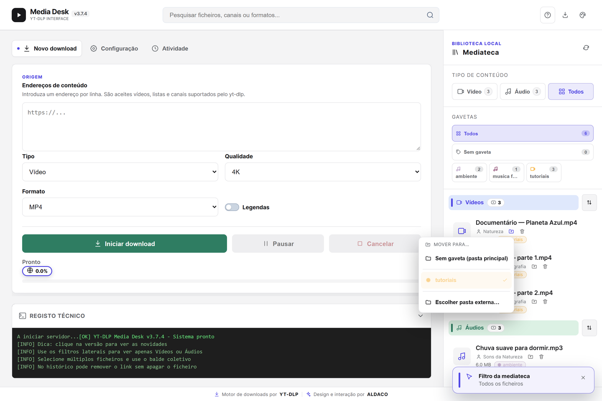
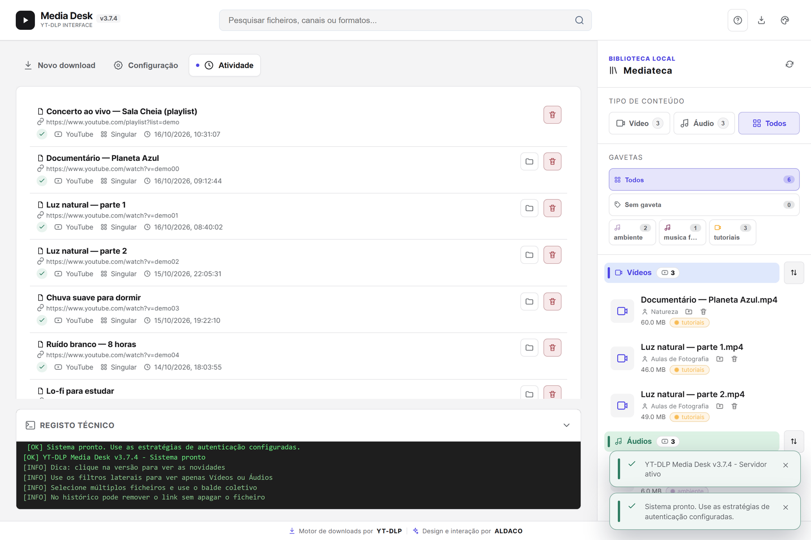
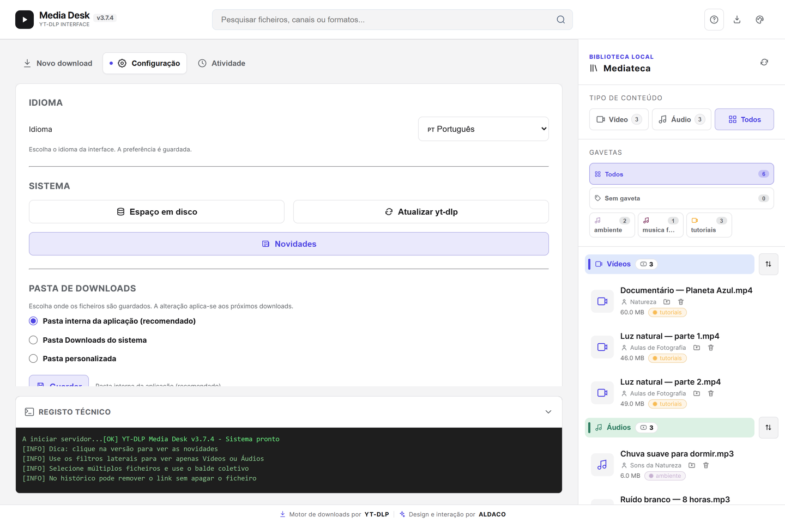

# YT-DLP Media Desk

[](LICENSE)
[](https://github.com/nunodacosta/MediaDesk/releases/latest)
[](https://github.com/nunodacosta/MediaDesk/releases)
[](https://github.com/nunodacosta/MediaDesk/releases/latest)

**English** · [Português](#português)

A **local** desktop interface for **[yt-dlp](https://github.com/yt-dlp/yt-dlp)** — download and organise video/audio, with no account and no telemetry.



- **Download** video and audio with yt-dlp, choosing format and quality.
- **Media library** that scans and organises your downloads folder automatically.
- **Drawers:** real subfolders (Video or Audio), each with **its own colour**, shown as a grid in the sidebar with a per-type filter. Every file shows its drawer and can be moved between drawers of the same type — or to an external folder — from the file's own menu.
- **Activity** with the download history and the drawer each file went to.
- **5 languages** (PT/EN/ES/FR/DE), light/dark themes and colour palettes.

**Download:** [Releases](https://github.com/nunodacosta/MediaDesk/releases) — portable `MediaDesk-Portable.zip` (recommended), self-extracting `.exe`, or `MediaDesk-Setup.exe`, all with SHA-256 hashes.

> **Code signing policy:** the executables on that page are signed by the **SignPath Foundation** — *free code signing provided by [SignPath.io](https://about.signpath.io), certificate by [SignPath Foundation](https://signpath.org)*. Details in [`CODE_SIGNING_POLICY.md`](CODE_SIGNING_POLICY.md).

---

## Português

Interface de desktop **local** para o **[yt-dlp](https://github.com/yt-dlp/yt-dlp)** — transferir e organizar vídeo/áudio de forma simples, sem conta e sem telemetria.

- **Licença:** GNU GPL-3.0 (ver [`LICENSE`](LICENSE))
- **Autor:** Alexandre da Costa / ALDACO
- **Versão:** 3.7.4

> Este programa **não transfere qualquer informação** para outros sistemas em rede a menos que tal seja especificamente solicitado pelo utilizador. Ver a **[Code signing policy](CODE_SIGNING_POLICY.md)** (política de assinatura de código e privacidade).

## Principais funcionalidades

- **Download** de vídeo e áudio com o yt-dlp, com escolha de formato/qualidade.
- **Mediateca** local que organiza automaticamente a pasta de downloads.
- **Gavetas:** subpastas reais (Vídeo ou Áudio) com **cor própria**, grelha no
  painel lateral, contagem de ficheiros e filtro por tipo. Cada ficheiro mostra a
  sua gaveta e pode ser movido entre gavetas do mesmo tipo — ou para uma pasta
  externa — pelo menu da carta. Uma gaveta pode ser removida da sua carta,
  mantendo os ficheiros (movidos para «Sem gaveta») ou apagando-os.
- **Atividade** com o histórico dos downloads e a gaveta de cada ficheiro.
- **Interface em 5 idiomas** (PT/EN/ES/FR/DE), temas claro/escuro e paletas de cor.

## Capturas de ecrã

**Mediateca** — os ficheiros organizados por tipo, cada um com a sua gaveta, e a grelha de gavetas no painel lateral.



**Gavetas** — mover um ficheiro entre gavetas (ou para uma pasta externa) pelo menu da carta.



**Atividade** — histórico dos downloads com o estado e a gaveta de cada ficheiro.



**Configuração** — temas, idioma, gavetas e opções do yt-dlp.



## Descarga

Na página de [Releases](https://github.com/nunodacosta/MediaDesk/releases):

| Ficheiro | Descrição |
|---|---|
| `MediaDesk-Portable.zip` | Versão portátil — descompactar e executar (**recomendado**) |
| `MediaDesk-Portable.exe` | Auto-extraível (extrai e executa) |
| `MediaDesk-Setup.exe` | Instalador por utilizador (Inno Setup) |
| `SHA256SUMS.txt` | Hashes SHA-256 dos artefactos |

> **Code signing policy:** os executáveis desta página são assinados pela **SignPath Foundation** — *free code signing provided by [SignPath.io](https://about.signpath.io), certificate by [SignPath Foundation](https://signpath.org)*. Detalhes em [`CODE_SIGNING_POLICY.md`](CODE_SIGNING_POLICY.md).

### Verificar a integridade

```powershell
# Windows
Get-FileHash .\MediaDesk-Portable.zip -Algorithm SHA256   # comparar com SHA256SUMS.txt
```

```bash
# Linux / macOS
sha256sum -c SHA256SUMS.txt
```

## Assinatura de código (Code signing policy)

Os executáveis de release são assinados através da **SignPath Foundation** — *free code signing provided by [SignPath.io](https://about.signpath.io), certificate by [SignPath Foundation](https://signpath.org)*. Quem assina, como verificar a assinatura e a política de privacidade estão em **[`CODE_SIGNING_POLICY.md`](CODE_SIGNING_POLICY.md)**.

## Compilar a partir do código

Requer Windows, **SDK do .NET 8**, **Inno Setup 6** e o runtime em `bin\` (Python, yt-dlp, FFmpeg, Deno):

```powershell
.\build_portable.ps1          # gera dist\ (pasta portátil, SFX, Setup, hashes)
.\verificar-integridade.ps1   # valida os ficheiros da aplicação
```

## Estrutura

```
server.py                 servidor local (a aplicação)
index.html                interface (WebView2)
Program.cs                launcher (WinForms + WebView2)
build_portable.ps1        build da release
installer/mediadesk.iss   script do Inno Setup
tools/                    scripts auxiliares (hashes, versão, SignPath)
licenses/                 licenças de terceiros
```

## Notas técnicas do launcher

- **Encerramento seguro:** o launcher cria um *Windows Job Object* com `KILL_ON_JOB_CLOSE`. O Python iniciado e os seus processos-filho (yt-dlp, FFmpeg, PowerShell) ficam associados ao Job; ao fechar a janela, só essa árvore é terminada. Processos alheios à aplicação não são tocados.
- **WebView2:** requer o WebView2 Runtime (presente no Windows 11 e em muitos Windows 10). Para portabilidade offline total, distribuir o *Fixed Runtime* e adaptar `EnsureCoreWebView2Async`.
- **Zero instalação:** distribuir `bin\python` já preparado com as dependências.

## Licença

Software livre — **GNU GPL-3.0** (ver [`LICENSE`](LICENSE)). © 2026 Alexandre da Costa / ALDACO. Créditos: conceito, design e direção de Alexandre da Costa / ALDACO; implementação técnica assistida por IA, sob direção do autor. Ver [`licenses/ALDACO-IP-NOTICE.txt`](licenses/ALDACO-IP-NOTICE.txt) e [`licenses.json`](licenses.json).

### Componentes de terceiros e código-fonte

Cada distribuição inclui, na pasta [`licenses/`](licenses), os textos integrais das licenças e os avisos dos componentes de terceiros. Para os componentes sob **GPL** (FFmpeg), é disponibilizada a oferta do **código-fonte correspondente**:

- [`licenses/FFmpeg-NOTICE.txt`](licenses/FFmpeg-NOTICE.txt) — revisão exata do FFmpeg distribuída, localização do código-fonte correspondente e **oferta escrita** (GPL-3.0, secção 6). Gerado automaticamente a partir do binário empacotado, para garantir que a revisão indicada corresponde ao que é distribuído.
- [`licenses/SOURCE-OFFER.txt`](licenses/SOURCE-OFFER.txt) — mapa de **todos** os componentes redistribuídos (aplicação, FFmpeg, yt-dlp, Python, Deno, .NET, WebView2) com licença e localização do código-fonte.
- [`licenses/THIRD-PARTY-NOTICES.txt`](licenses/THIRD-PARTY-NOTICES.txt) — avisos de terceiros.

O gerador é [`tools/gen_licenses_notice.ps1`](tools/gen_licenses_notice.ps1) e corre automaticamente no `build_portable.ps1`.
